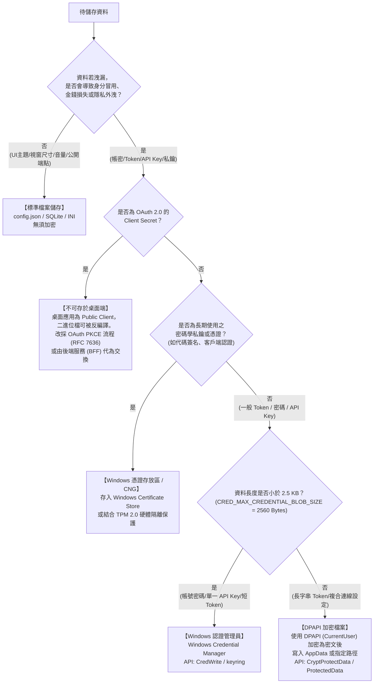

# Windows 桌面憑證儲存：架構決策與常見誤區速查

本文件為檢驗「手上的敏感資料該放哪裡？用什麼 API？以及有哪些可能有所誤會的資安陷阱。」提供規格與決策流程。

---

## 1. 敏感資料儲存決策流程

遇到資料儲存需求時，依此流程判定存放位置與安全機制：



---

## 2. Windows 4 大儲存方案技術規格與限制

| 方案 | 適用資料類型 | 容量限制 | 防護特性 | 邊界與限制 |
|---|---|:---:|---|---|
| **Windows Credential Manager**<br>*(認證管理員)* | 使用者帳號密碼、第三方 API Key、短期 Token | **2560 Bytes**<br>(約 2.5 KB) | Windows 原生憑證庫；設定檔僅記錄識別鍵值，不留敏感字串。 | 無法容納超長 Token；無法防範同 Windows 使用者權限下運行的惡意程式調用 `CredRead`。 |
| **DPAPI (CurrentUser)**<br>*(資料保護 API)* | 長字串 Token、大量連線機密、本地資料庫金鑰 | **無硬性限制**<br>(受檔案系統限制) | 由使用者登入憑據自動衍生金鑰，直接產出密文持久化。 | 限同主機同使用者帳號解密；若使用者強制重設 Windows 密碼可能導致金鑰損毀。 |
| **Windows Certificate Store / CNG** | 代碼簽名私鑰、TLS 客戶端認證金鑰、硬體憑證 | 依憑證規格 | 支援 TPM 2.0 硬體防護與非匯出性標記。 | API 調用程序較繁瑣，一般 API Key 無須採用此架構。 |
| **標準檔案 (JSON / INI / SQLite)** | 視窗尺寸、介面主題、語系設定、公開 Client ID | 無限制 | 讀寫直觀、不具依賴、人眼可讀。 | **無密碼學防護**。本機任何程序皆可直接讀取明文。 |

---

## 3. 常見的資安認知誤區

開發桌面應用程式時，以下做法經常被誤認為具備保護效果，實質上並不提供安全保障：

### 誤區 1：將機密存於 AppData 目錄即可獲得安全保護
- **分析**：`%APPDATA%` 僅為標準檔案系統路徑，並無沙盒隔離機制。任何在同一 Windows 使用者帳號下運行的非特權程序，皆可讀取該目錄下的明文檔案。

### 誤區 2：使用 Base64 或自訂 XOR / 靜態金鑰進行混淆
- **分析**：Base64 僅為資料編碼，不具保密性；原始碼中寫死的 AES 金鑰或 XOR 邏輯，可輕易透過反編譯工具還原。敏感資料應依賴作業系統原生 DPAPI 進行保護。

### 誤區 3：已將設定檔加入 .gitignore 即可保證安全
- **分析**：`.gitignore` 僅能避免檔案被提交至版本控制倉庫，無法保護終端使用者硬碟上的明文資料。

### 誤區 4：刪除機密檔案時透過覆寫 0 即可物理銷毀
- **分析**：現代固態硬碟 (SSD) 具備磨損均衡 (Wear Leveling) 機制，應用層寫入操作會被重新映射至新區塊，舊資料可能仍留存於快閃記憶體中。機密若曾以明文形式留存，應至伺服端進行撤銷與輪替 (Rotate / Revoke)。

### 誤區 5：採用 DPAPI 或 Credential Manager 即可防範所有惡意攻擊
- **分析**：Windows 原生防護機制的邊界在於防範離線硬碟提取與跨使用者存取。若攻擊程式已在同一登入使用者身分下運行，仍可調用系統 API 進行解密。高敏感操作應搭配使用者認證（如 Windows Hello 提權確認）。

---

## 4. 解密失敗處置原則 (Fail-Closed)

當使用者密碼遭重設或金鑰資料損壞，解密調用可能引發例外（如 `CryptographicException`）：

1. **嚴禁回退為明文儲存 (No Silent Fallback)**：不得於 catch 區塊中改將資料以未加密形式寫入磁碟。
2. **退回記憶體暫存 (Session Memory)**：若無法完成安全持久化，僅將憑據保留於當前執行時期記憶體中，程式結束即釋放。
3. **清除失效密文並提示重新驗證 (Recovery Flow)**：移除無法解密的損毀檔案，提示使用者重新登入以生成新憑據。

---

## 5. 各語言標準調用範例

### 🔹 .NET / C# (DPAPI CurrentUser)
```csharp
using System.Security.Cryptography;
using System.Text;

// 加密儲存
byte[] plain = Encoding.UTF8.GetBytes("my_secret_token");
byte[] cipher = ProtectedData.Protect(plain, null, DataProtectionScope.CurrentUser);
File.WriteAllBytes("token.bin", cipher);

// 讀取解密
byte[] cipher = File.ReadAllBytes("token.bin");
byte[] plain = ProtectedData.Unprotect(cipher, null, DataProtectionScope.CurrentUser);
string token = Encoding.UTF8.GetString(plain);
```

### 🔹 Python (Windows Credential Manager)
```python
import keyring

# 寫入認證管理員
keyring.set_password("MyDesktopApp", "user_access_token", "secret_value_here")

# 讀取認證
token = keyring.get_password("MyDesktopApp", "user_access_token")
```

### 🔹 Electron (safeStorage - 主行程 Main Process)
```javascript
const { safeStorage } = require('electron');
const fs = require('fs');

// 加密儲存
if (safeStorage.isEncryptionAvailable()) {
  const cipher = safeStorage.encryptString("my_secret_token");
  fs.writeFileSync("token.bin", cipher);
}

// 讀取解密
const cipher = fs.readFileSync("token.bin");
const token = safeStorage.decryptString(cipher);
```

### 🔹 桌面端 OAuth 2.0 (PKCE 規範)
```text
授權請求：/oauth/authorize?response_type=code&client_id=MY_ID&code_challenge=BASE64URL(SHA256(verifier))&code_challenge_method=S256
換取 Token：/oauth/token?grant_type=authorization_code&client_id=MY_ID&code_verifier=my_random_verifier&code=AUTH_CODE
說明：流程中不應包含 Client Secret。
```

---

## 6. 安全掃描執行與結果分析指引

### 步驟一：執行掃描方式

#### 方式 A：執行檔操作
1. 執行 `dist\win-secret-scanner.exe`。
2. 輸入或拖曳欲檢查的專案資料夾路徑，按 Enter 執行掃描。
3. 掃描完成後依提示選擇是否匯出報告（HTML 與 Markdown）。
4. 結束時可依選單選擇 `[1] 繼續掃描其他資料夾` 或 `[2] 離開程式`。

#### 方式 B：命令列操作
- **終端機輸出**：
  ```powershell
  python win_secret_scanner.py path/to/your/project
  # 或使用執行檔：
  .\dist\win-secret-scanner.exe path/to/your/project
  ```
- **產出 HTML 審查報告**：
  ```powershell
  python win_secret_scanner.py path/to/your/project --format html
  ```
- **產出結構化 JSON**：
  ```powershell
  python win_secret_scanner.py path/to/your/project --format json -o audit-report.json
  ```
- **執行測試套件**：
  ```powershell
  python run_tests.py
  ```

---

### 步驟二：檢核結果分析

1. **總評結果 (Overall Verdict)**：
   - `PASS`：未檢出機密明文持久化或寫死 Client Secret。
   - `CRITICAL` / `HIGH`：檢出高風險項目（如寫死 Client Secret、明文持久化至 AppData、或金鑰輸出至記錄檔）。
2. **問題代碼位置 (Vulnerable Code)**：
   - 報告列出所屬檔案路徑、行號及相關程式碼片段。
3. **修復建議 (Remediation Guidance)**：
   - 參照報告提供的修正指引調整儲存機制，修復後可重新掃描驗證。

---

### 步驟三：報告存放位置
- **路徑**：預設儲存於被掃描專案的根目錄。
- **命名格式**：檔名後綴包含產出時間戳（`audit-report_yyyyMMddHHmm.html` 與 `.md`）。
